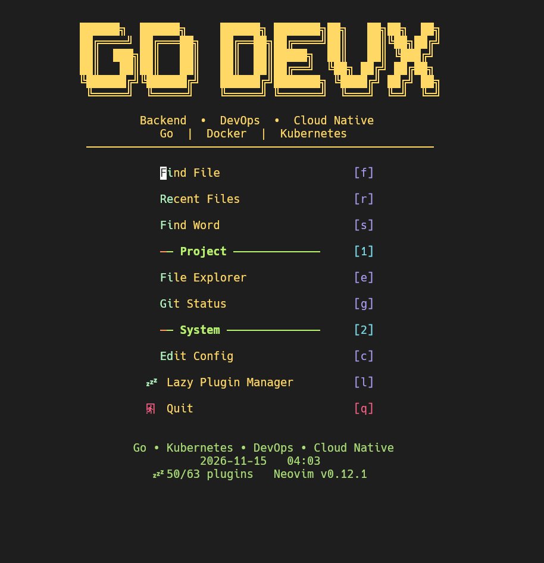
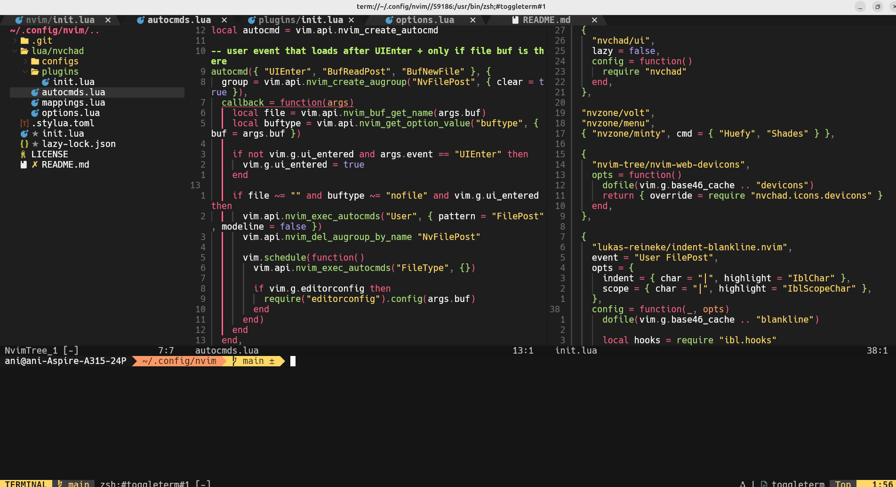
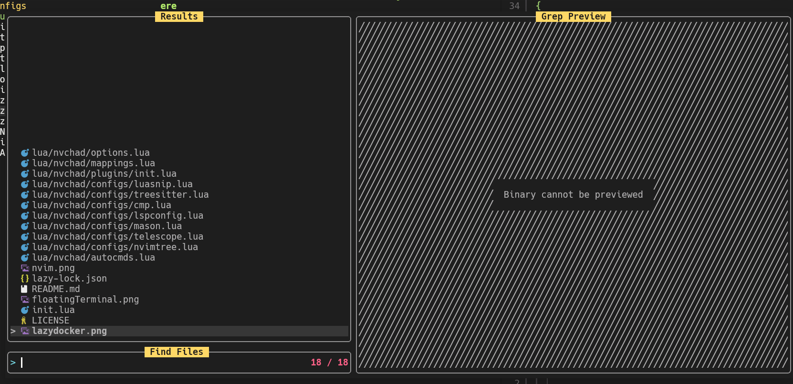
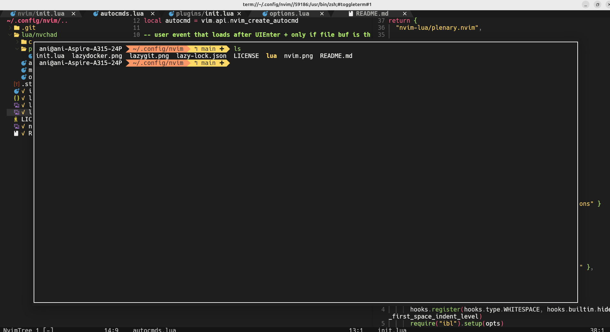
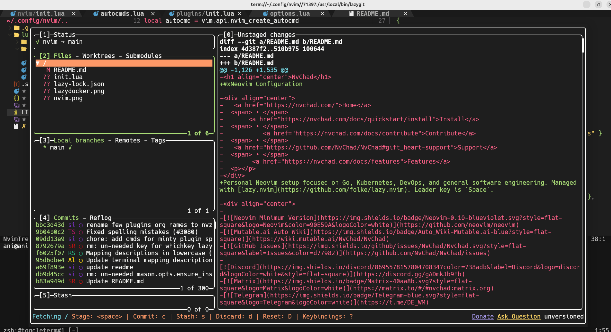
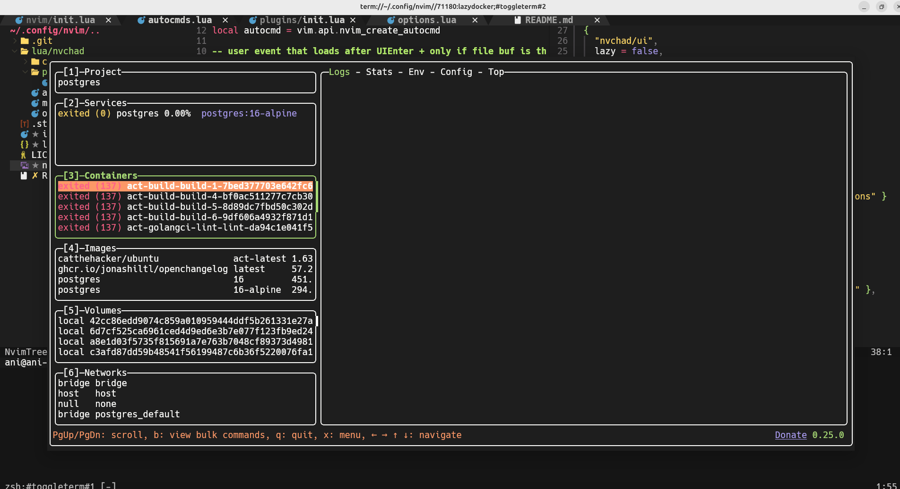

# Neovim Configuration

Personal Neovim setup focused on Go, Kubernetes, DevOps, and general software engineering. Managed with [lazy.nvim](https://github.com/folke/lazy.nvim). Leader key is `Space`.

This repository is meant to be copied into `~/.config/nvim` so you can reuse the same workflow, plugins, and keybindings.

<p align="center">
  
</p>

<p align="center"><em>Startup dashboard (dashboard-nvim) after a fresh launch</em></p>

---

## Showcase


### Editor layout (splits + file tree + bottom terminal)

NvimTree on the left, vertical splits for code, BufferLine tabs on top, and a ToggleTerm shell at the bottom.

<p align="center">
  
</p>

### Fuzzy finder (Telescope)

`Space` + `ff` opens find-files with a live preview pane.

<p align="center">
  
</p>

### Floating terminal

`tt` or `Space` + `tf` opens a centered floating zsh terminal over your buffers.

<p align="center">
  
</p>

### LazyGit

`Space` + `lg` toggles LazyGit in a float. Press the same keys again to close it.

<p align="center">
  
</p>

### LazyDocker

`Space` + `d` toggles LazyDocker the same way (open and close with one binding).

<p align="center">
  
</p>

---

## Requirements

| Tool | Version / notes | Link |
|------|-----------------|------|
| Neovim | 0.10+ (0.11+ recommended for current LSP APIs) | https://neovim.io/ |
| Git | Required to clone plugins | https://git-scm.com/ |
| Nerd Font | Powerline glyphs for UI and terminal prompts (agnoster, etc.) | https://www.nerdfonts.com/ |
| ripgrep | Telescope live grep | https://github.com/BurntSushi/ripgrep |
| fd (optional) | Faster file finding | https://github.com/sharkdp/fd |
| Node.js | Copilot, some Mason tools, Peek (markdown) | https://nodejs.org/ |
| Go (optional) | gopls, gofmt, goimports, neotest-go | https://go.dev/ |
| Python 3 (optional) | pyright, black | https://www.python.org/ |
| zsh (optional) | Default shell inside ToggleTerm (`vim.opt.shell`) | https://www.zsh.org/ |

### Optional CLI integrations

These are launched from Neovim keybindings. Install only what you need:

| Tool | Purpose | Install / docs |
|------|---------|----------------|
| LazyGit | TUI Git client (`Space` + `lg`) | https://github.com/jesseduffield/lazygit |
| LazyDocker | TUI Docker client (`Space` + `d`) | https://github.com/jesseduffield/lazydocker |
| k9s | Kubernetes TUI (`Space` + `k`) | https://k9scli.io/ |
| sshfs / fuse | Remote SSHFS mounts (`Space` + `rc`) | https://github.com/libfuse/sshfs |
| Docker language server | Docker LSP (Mason / dockerls) | https://github.com/docker/docker-language-server |

### Formatters (Conform)

Install these on your PATH (or via Mason / package manager) for format-on-save:

| Formatter | Languages | Link |
|-----------|-----------|------|
| clang-format | C / C++ | https://clang.llvm.org/docs/ClangFormat.html |
| gofmt / goimports | Go | https://pkg.go.dev/golang.org/x/tools/cmd/goimports |
| stylua | Lua | https://github.com/JohnnyMorganz/StyLua |
| black | Python | https://github.com/psf/black |
| prettier | JS/TS, JSON, YAML, Markdown, HTML, CSS | https://prettier.io/ |
| shfmt | Shell | https://github.com/mvdan/sh |

---

## Installation

### 1. Backup any existing config

```bash
mv ~/.config/nvim ~/.config/nvim.bak
mv ~/.local/share/nvim ~/.local/share/nvim.bak 2>/dev/null
mv ~/.local/state/nvim ~/.local/state/nvim.bak 2>/dev/null
```

### 2. Clone this configuration

```bash
git clone https://github.com/KakshiDEV56/nvim-config.git ~/.config/nvim
```

Repo: https://github.com/KakshiDEV56/nvim-config

If you already have the files locally (for example this machine), ensure at least these exist under `~/.config/nvim`:

- `init.lua` (main config and keymaps)
- `lazy-lock.json` (pinned plugin versions, optional but recommended)
- `public/` (screenshots used by this README)

### 3. Install a Nerd Font and set it in your terminal

Recommended fonts already used with this setup:

- JetBrainsMono Nerd Font
- Iosevka / IosevkaTerm Nerd Font
- Hack Nerd Font

Set the font in your terminal emulator (Kitty, Ghostty, WezTerm, etc.), then restart the terminal.

### 4. Install system dependencies

**Ubuntu / Debian example:**

```bash
sudo apt update
sudo apt install -y neovim git ripgrep fd-find curl build-essential
# Optional TUIs
# https://github.com/jesseduffield/lazygit#installation
# https://github.com/jesseduffield/lazydocker#installation
# https://k9scli.io/topics/install/
```

**Arch example:**

```bash
sudo pacman -S neovim git ripgrep fd
# yay -S lazygit lazydocker k9s
```

**macOS (Homebrew):**

```bash
brew install neovim git ripgrep fd lazygit lazydocker k9s
```

### 5. First launch

```bash
nvim
```

On first start, [lazy.nvim](https://github.com/folke/lazy.nvim) bootstraps itself, then installs all plugins from `init.lua` / `lazy-lock.json`. Wait until Lazy finishes. You should land on the dashboard shown at the top of this README.

Then open Mason and confirm language servers:

```vim
:Mason
```

Expected servers (auto-installed via mason-lspconfig):

- `gopls`
- `ts_ls`
- `pyright`
- `yamlls`
- `dockerls`
- `bashls`
- `jsonls`
- `eslint`

### 6. GitHub Copilot (optional)

1. Install the plugin (already in the plugin list; loads on first run).
2. Authenticate:

```vim
:Copilot setup
```

Docs: https://github.com/github/copilot.vim

Copilot Chat: https://github.com/CopilotC-Nvim/CopilotChat.nvim

Autocomplete and Copilot suggestions are **off by default**. Toggle with `Space` + `tc`.

### 7. Shell theme inside Neovim terminal (optional)

ToggleTerm uses `/usr/bin/zsh`. If you use Oh My Zsh with the agnoster theme, the same prompt appears inside Neovim:

```bash
# In ~/.zshrc
ZSH_THEME="agnoster"
```

Oh My Zsh: https://ohmyz.sh/  
Agnoster theme: https://github.com/ohmyzsh/ohmyzsh/wiki/Themes#agnoster

---

## Features overview

- Plugin manager: [lazy.nvim](https://github.com/folke/lazy.nvim)
- Theme: [Monokai Pro](https://github.com/loctvl842/monokai-pro.nvim)
- File explorer: [nvim-tree](https://github.com/nvim-tree/nvim-tree.lua)
- Fuzzy finder: [Telescope](https://github.com/nvim-telescope/telescope.nvim)
- LSP: [nvim-lspconfig](https://github.com/neovim/nvim-lspconfig) + [Mason](https://github.com/williamboman/mason.nvim) + [LSPsaga](https://github.com/nvimdev/lspsaga.nvim)
- Completion: [nvim-cmp](https://github.com/hrsh7th/nvim-cmp) + [LuaSnip](https://github.com/L3MON4D3/LuaSnip)
- Formatting: [Conform](https://github.com/stevearc/conform.nvim) (format on save)
- Git: Fugitive, Gitsigns, Diffview, LazyGit, Flog
- Terminal: [ToggleTerm](https://github.com/akinsho/toggleterm.nvim)
- Diagnostics panel: [Trouble](https://github.com/folke/trouble.nvim)
- Marks: [Harpoon](https://github.com/ThePrimeagen/harpoon)
- Dashboard: [dashboard-nvim](https://github.com/nvimdev/dashboard-nvim)
- Autosave on InsertLeave / FocusLost / BufLeave
- TUI toggles for LazyGit, LazyDocker, and k9s (same key opens and closes)

---

## Keybindings

Leader = `Space`. Modes: `n` normal, `i` insert, `v`/`x` visual, `t` terminal.

### General editing

| Keys | Mode | Action |
|------|------|--------|
| `jj` | i / v | Escape to normal mode |
| `jj` | t | Leave terminal mode |
| `Esc` | t | Leave terminal mode |
| `qa` | n | Save all buffers, kill terminal jobs, quit Neovim |
| `Ctrl` + `z` | n | Undo |
| `Ctrl` + `z` | i | Undo and return to insert |
| `Ctrl` + `f` | n | Search (`/`) |
| `Alt` + `j` | n | Move line down |
| `Alt` + `k` | n | Move line up |
| `u` | x | Move selection up |
| `e` | x | Move selection down |
| `cc` | n / i | In C/C++/Go: insert `/*  */` with cursor inside; otherwise normal `cc` |

### Files, search, explorer

| Keys | Mode | Action |
|------|------|--------|
| `Space` + `e` | n | Toggle NvimTree |
| `Space` + `ff` | n | Telescope find files |
| `Space` + `fg` | n | Telescope live grep |
| `Space` + `fw` | n | Telescope grep string under cursor |
| `Space` + `fb` | n | Telescope buffers |
| `Space` + `S` | n | Spectre project search/replace |
| `Tab` | n | Next buffer (BufferLine) |
| `Shift` + `Tab` | n | Previous buffer |

### Window navigation and splits

| Keys | Mode | Action |
|------|------|--------|
| `vs` | n | Vertical split |
| `Space` + `sv` | n | Split vertical |
| `Space` + `sh` | n | Split horizontal |
| `Space` + `se` | n | Equalize splits |
| `Space` + `sx` | n | Close split |
| `Ctrl` + `h` / `j` / `k` / `l` | n | Move to left / down / up / right window |
| `Ctrl` + `1` | n / i / v / t | Focus file explorer (NvimTree) |
| `Ctrl` + `2` | n / i / v / t | Focus first editor window |
| `Ctrl` + `3` | n / i / v / t | Focus second editor window |

Note: ToggleTerm windows are excluded from `Ctrl` + `1` / `2` / `3` so the terminal does not take an editor slot.

### Terminal (ToggleTerm)

| Keys | Mode | Action |
|------|------|--------|
| `th` | n | Toggle horizontal terminal (bottom) |
| `Alt` + `h` | n / t | Toggle horizontal terminal (works inside the terminal) |
| `tt` | n | Toggle floating terminal |
| `Space` + `th` | n / t | Toggle horizontal terminal |
| `Space` + `tv` | n / t | Toggle vertical terminal |
| `Space` + `tf` | n / t | Toggle floating terminal |
| `Ctrl` + `\` | n | ToggleTerm open mapping (plugin default) |

### Completion and AI

| Keys | Mode | Action |
|------|------|--------|
| `Space` + `tc` | n | Toggle autocomplete + Copilot on/off |
| `Ctrl` + `Space` | i | Manual completion (when cmp is active) |
| `Tab` / `Shift` + `Tab` | i | Next / previous completion item (when autocomplete is on) |
| `Space` + `cc` | n / v | Copilot Chat |
| `Space` + `ce` | n | Copilot Chat: explain |
| `Space` + `cf` | n | Copilot Chat: fix |
| `Space` + `ct` | n | Copilot Chat: tests |
| `Space` + `cr` | n | Copilot Chat: review |

### LSP and code intelligence

| Keys | Mode | Action |
|------|------|--------|
| `K` | n | Hover docs (LSPsaga) |
| `gd` | n | Go to definition |
| `gp` | n | Peek definition |
| `gt` | n | Peek type definition |
| `gr` | n | Finder (references / implementations UI) |
| `gi` | n | Go to implementation |
| `Space` + `ca` | n | Code action |
| `Space` + `rn` | n | Incremental rename (`:IncRename`) |
| `Space` + `fm` | n / v | Format with Conform |
| `ee` | n | Trouble: diagnostics for current file |
| `Space` + `xx` | n | Trouble: toggle diagnostics |
| `Space` + `xw` | n | Trouble: workspace diagnostics |

### Git

| Keys | Mode | Action |
|------|------|--------|
| `Space` + `gs` | n | Fugitive status (`:Git`) |
| `Space` + `ga` | n | `git add .` |
| `Space` + `gc` | n | `git commit` |
| `Space` + `gd` | n | Diffview open |
| `Space` + `gh` | n | Diffview file history |
| `Space` + `lg` | n / t | Toggle LazyGit (same key closes) |
| `Space` + `gl` | n | Flog (git log graph) |

### Harpoon

| Keys | Mode | Action |
|------|------|--------|
| `Space` + `ha` | n | Add current file to Harpoon |
| `Space` + `hh` | n | Harpoon quick menu |
| `Space` + `1` .. `4` | n | Jump to Harpoon mark 1-4 |

### Motion (Hop)

| Keys | Mode | Action |
|------|------|--------|
| `s` | n | Hop to word |
| `S` | n | Hop to line |

### Markdown

| Keys | Mode | Action |
|------|------|--------|
| `Space` + `mo` | n | Peek markdown preview open |
| `Space` + `mc` | n | Peek markdown preview close |
| `Space` + `mr` | n | Toggle in-editor render-markdown |
| `Space` + `me` | n | Enable render-markdown |
| `Space` + `md` | n | Disable render-markdown |

### HTTP / API (Kulala)

| Keys | Mode | Action |
|------|------|--------|
| `Space` + `rr` | n | Run request |
| `Space` + `rp` | n | Jump to previous request |
| `Space` + `ri` | n | Inspect request |

Kulala docs: https://github.com/mistweaverco/kulala.nvim

### Infra, Docker, Kubernetes, remote

| Keys | Mode | Action |
|------|------|--------|
| `Space` + `d` | n / t | Toggle LazyDocker (same key closes) |
| `Space` + `k` | n / t | Toggle k9s (same key closes) |
| `Space` + `rc` | n | Remote SSHFS connect |
| `Space` + `rd` | n | Remote SSHFS disconnect |
| `Space` + `db` | n | Dadbod UI toggle |
| `Space` + `or` | n | Overseer run task |

Remote SSHFS plugin: https://github.com/nosduco/remote-sshfs.nvim  
Dadbod UI: https://github.com/kristijanhusak/vim-dadbod-ui  
Overseer: https://github.com/stevearc/overseer.nvim

### Tests

| Keys | Mode | Action |
|------|------|--------|
| `Space` + `tr` | n | Neotest: run nearest test (Go via neotest-go) |
| `Space` + `ts` | n | Neotest: toggle summary |

Neotest: https://github.com/nvim-neotest/neotest

---

## Third-party plugins and links

### Core

| Plugin | Link |
|--------|------|
| lazy.nvim | https://github.com/folke/lazy.nvim |
| nvim-treesitter | https://github.com/nvim-treesitter/nvim-treesitter |
| plenary.nvim | https://github.com/nvim-lua/plenary.nvim |
| nvim-web-devicons | https://github.com/nvim-tree/nvim-web-devicons |

### UI

| Plugin | Link |
|--------|------|
| monokai-pro.nvim | https://github.com/loctvl842/monokai-pro.nvim |
| lualine.nvim | https://github.com/nvim-lualine/lualine.nvim |
| bufferline.nvim | https://github.com/akinsho/bufferline.nvim |
| dashboard-nvim | https://github.com/nvimdev/dashboard-nvim |
| noice.nvim | https://github.com/folke/noice.nvim |
| nvim-notify | https://github.com/rcarriga/nvim-notify |
| which-key.nvim | https://github.com/folke/which-key.nvim |
| indent-blankline.nvim | https://github.com/lukas-reineke/indent-blankline.nvim |
| neoscroll.nvim | https://github.com/karb94/neoscroll.nvim |

### Navigation and editing

| Plugin | Link |
|--------|------|
| telescope.nvim | https://github.com/nvim-telescope/telescope.nvim |
| nvim-tree.lua | https://github.com/nvim-tree/nvim-tree.lua |
| hop.nvim | https://github.com/smoka7/hop.nvim |
| harpoon | https://github.com/ThePrimeagen/harpoon |
| nvim-spectre | https://github.com/nvim-pack/nvim-spectre |
| nvim-autopairs | https://github.com/windwp/nvim-autopairs |
| Comment.nvim | https://github.com/numToStr/Comment.nvim |
| toggleterm.nvim | https://github.com/akinsho/toggleterm.nvim |

### LSP, completion, format

| Plugin | Link |
|--------|------|
| nvim-lspconfig | https://github.com/neovim/nvim-lspconfig |
| mason.nvim | https://github.com/williamboman/mason.nvim |
| mason-lspconfig.nvim | https://github.com/williamboman/mason-lspconfig.nvim |
| lspsaga.nvim | https://github.com/nvimdev/lspsaga.nvim |
| lsp_signature.nvim | https://github.com/ray-x/lsp_signature.nvim |
| inc-rename.nvim | https://github.com/smjonas/inc-rename.nvim |
| trouble.nvim | https://github.com/folke/trouble.nvim |
| nvim-cmp | https://github.com/hrsh7th/nvim-cmp |
| LuaSnip | https://github.com/L3MON4D3/LuaSnip |
| conform.nvim | https://github.com/stevearc/conform.nvim |

### Git

| Plugin | Link |
|--------|------|
| vim-fugitive | https://github.com/tpope/vim-fugitive |
| gitsigns.nvim | https://github.com/lewis6991/gitsigns.nvim |
| diffview.nvim | https://github.com/sindrets/diffview.nvim |
| lazygit.nvim | https://github.com/kdheepak/lazygit.nvim |
| vim-flog | https://github.com/rbong/vim-flog |

### AI

| Plugin | Link |
|--------|------|
| copilot.vim | https://github.com/github/copilot.vim |
| CopilotChat.nvim | https://github.com/CopilotC-Nvim/CopilotChat.nvim |

### Markdown

| Plugin | Link |
|--------|------|
| render-markdown.nvim | https://github.com/MeanderingProgrammer/render-markdown.nvim |
| peek.nvim | https://github.com/toppair/peek.nvim |

### DevOps / language helpers

| Plugin | Link |
|--------|------|
| remote-sshfs.nvim | https://github.com/nosduco/remote-sshfs.nvim |
| kulala.nvim | https://github.com/mistweaverco/kulala.nvim |
| nvim-dev-container | https://github.com/esensar/nvim-dev-container |
| vim-terraform | https://github.com/hashivim/vim-terraform |
| vim-helm | https://github.com/towolf/vim-helm |
| yaml-companion.nvim | https://github.com/someone-stole-my-name/yaml-companion.nvim |
| ansible-vim | https://github.com/pearofducks/ansible-vim |
| nginx.vim | https://github.com/chr4/nginx.vim |
| Dockerfile.vim | https://github.com/ekalinin/Dockerfile.vim |
| github-actions-yaml.vim | https://github.com/yasuhiroki/github-actions-yaml.vim |
| Jenkinsfile-vim-syntax | https://github.com/martinda/Jenkinsfile-vim-syntax |
| vim-dadbod | https://github.com/tpope/vim-dadbod |
| vim-dadbod-ui | https://github.com/kristijanhusak/vim-dadbod-ui |
| neotest | https://github.com/nvim-neotest/neotest |
| neotest-go | https://github.com/nvim-neotest/neotest-go |
| overseer.nvim | https://github.com/stevearc/overseer.nvim |

---

## Updating plugins

```vim
:Lazy sync
```

Or from the command line after opening Neovim once:

```vim
:Lazy update
```

Pinned commits live in `lazy-lock.json`. Commit that file if you want reproducible installs for others.

---

## Customizing

Almost everything lives in a single entry file:

```text
~/.config/nvim/init.lua
```

Common edits:

1. Keymaps: search for `vim.keymap.set` near the top of `init.lua`.
2. Plugins: search for `require("lazy").setup({`.
3. LSP servers: `ensure_installed` under mason-lspconfig, plus `vim.lsp.config` / `vim.lsp.enable` near the bottom.
4. Formatters: `formatters_by_ft` in the Conform setup.
5. Theme: Monokai Pro setup block (`loctvl842/monokai-pro.nvim`).

After editing `init.lua`:

```vim
:source %
```

Or restart Neovim. For plugin list changes, run `:Lazy sync`.

---

## Troubleshooting

**Plugins did not install**

```vim
:Lazy
```

Press `S` to sync, or run `:Lazy sync`. Check network and GitHub access.

**LSP not starting**

```vim
:Mason
:LspInfo
```

Install the missing server from Mason. Confirm the binary is on PATH.

**Ugly icons or broken prompt in terminal**

Install and select a Nerd Font in the host terminal. Restart the terminal and Neovim.

**Copilot not working**

```vim
:Copilot status
:Copilot setup
```

**LazyDocker / k9s / LazyGit keybind does nothing**

Install the CLI on your PATH, then retry the keybind. The same key toggles the TUI closed from inside the float.

**Quit blocked by "job still running"**

Use `qa` in normal mode. It saves all buffers, force-closes terminal jobs, then quits.

**Remote SSHFS fails**

Install `sshfs` and ensure FUSE is available on your OS. See https://github.com/nosduco/remote-sshfs.nvim

---

## License

See [LICENSE](./LICENSE) in this repository.
